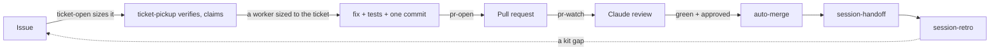
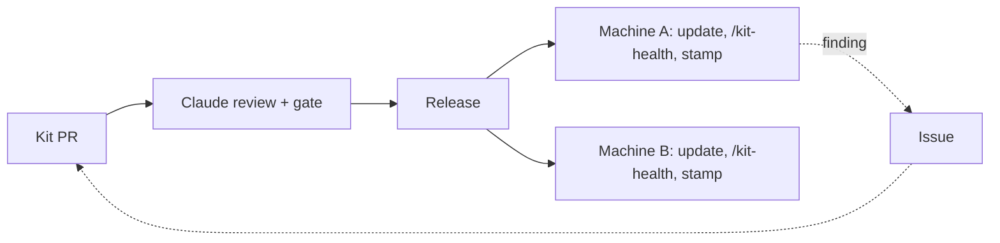

# bAIton

**`ai-baton` — a workspace kit for Claude Code: a context database that grows with every session, a live
registry of who works on what, and handoffs that let an initiative outlive any one session. Every machine checks
and updates its own copy.**

[](https://github.com/MdaaaaO/ai-baton/actions/workflows/ci.yml)
[](https://github.com/MdaaaaO/ai-baton/releases)
[](https://www.conventionalcommits.org)
[](docs/packaging.md)

What you get, from the top:

- **Context that accumulates.** `.context/` is an indexed markdown database beside your repos, optionally its own
  git repo that every machine pulls at session start. Each session adds what it learned; the next does not start cold.
- **Sessions choose their context.** The index names every doc and a brief per initiative; a session reads what it
  works on, not everything, so the loaded prefix and the cost stay small.
- **Initiatives outlive sessions.** One context doc per initiative. A session ends with a handoff prompt; its
  successor reads it back, checks each claim against the tracker and the PRs, and only then edits. A stale prompt is
  caught before it is acted on ([a real one](#a-handoff)).
- **A live registry.** Who works on what right now: heartbeats, the PRs each session watches, what each session
  cost. A second session coordinates instead of colliding.
- **Tooling, not prose.** Index, registry, session stats, health check and sync are scripts and hooks with zero
  model turns; the skills are the thin layer on top.
- **Lightweight.** One install command, one setup run, no names or ids in the kit. If you already start Claude Code
  from the directory that holds your repos, the first session benefits.

Plus skills for PRs, tickets, sessions and docs, and one store for per-machine values.

**Plugin**: Claude Code installs and updates it.

```sh
claude plugin marketplace add MdaaaaO/ai-baton && claude plugin install ai-baton@ai-baton-kit
cd ~/Projects && claude    # start Claude Code in your workspace root (the directory that holds your repos), then:
/kit-setup                 # runs the kit's setup.sh here; restart Claude Code, then in the first session:
/kit-health
```

**Clone**: the whole workspace kit, with the git hooks, the `make` targets and the fast-forward sync.

```sh
cd ~/Projects      # your workspace root: the directory that holds your repos
git clone https://github.com/MdaaaaO/ai-baton.git .claude && sh .claude/setup.sh --personal
# restart Claude Code, then in the first session:
/kit-health
```

> **Never use your home directory as the workspace root.** `~/.claude` is Claude Code's own config directory;
> `setup.sh` refuses `$HOME` as the workspace root.

**What it leaves on disk.** `setup.sh` creates a `.context/` tree beside your repos (memory, the env store, the
context DB), seeds a root `CLAUDE.md` and a root `Makefile` include only where none exists, and points Claude Code's
auto-memory directory at `.context/memory` through one symlink. It never writes into your repos. To remove it:
[`docs/troubleshooting.md` § 4 Uninstalling](docs/troubleshooting.md), or `claude plugin uninstall ai-baton@ai-baton-kit`
on the plugin path.

Both paths set `$BATON`, the kit root the docs write as `$BATON/…`: `.claude` on a clone, the plugin cache on a
plugin install. You never set it (`docs/glossary.md`).

## Your first session

A fresh install, trimmed (`…`) and redacted (`you` is the login). None of it calls a model:

```text
# SessionStart hook: the resolved profile, then WORKSPACE.md (the shared rules, 9,985 B)
resolved profile (kit_profile.py get):
  tracker: kind=github key_regex=… url_template=https://github.com/{repo}/issues/{key}
  systems on: <none>
  footer: none yet — `session-register` records the name; …
# Workspace — shared Claude Code context (core)  …

$ make -C $BATON/context-db session-register NAME=demo-first REF=demo EPIC=you/sample-repo#1 \
    REPOS=you/sample-repo WORKING="first session" RESP="demo"
registered sessions/demo-first.md
wrote SESSION_INDEX.md — 1 active, 0 ended listed, 0 with no prompt

$ python3 $BATON/skills/kit-health/kit-health.py --stale 90 --quiet
**AMBER** — 0 errors · 4 warnings · 29 checks passed · environment `you`
```

The first run is AMBER: each warning names its fix (here the unfetched ctx store and the missing stamp).

## A handoff

The handoff that produced this section, trimmed (`…`), the owner's name removed: the ending session's prompt, the
index's one-line starter, the successor's read-back before its first edit.

```text
$ make -C $BATON/context-db session-end NAME=kit-14 NEXT=…/next.md
ended sessions/kit-14.md (+ stats block, ledger row)
wrote SESSION_INDEX.md — 0 active, 1 ended listed, 0 with no prompt

# SESSION_INDEX.md § Ended — the paste-ready starter for the next session
Register as the successor of kit-14; your prompt is in sessions/kit-14.md § Next session.

# sessions/kit-14.md § Next session (what the successor reads)
Register as `kit-15`, successor of `kit-14` (`SUCCESSOR_OF=kit-14`), lane kit; epic: none open …
Owns: ai-baton worktrees, PRs, merges and the next release; do not touch the other lane's docs or worktrees.
State: v0.11.1 released 2026-10-17 and installed here (kit-health stamped at 150d3c8, AMBER: one doc size).
Open issues (2): #587 stays open until the other environment runs `/memory-prune` — do not close it from here.
First task: … triage anything new (contributor PRs are reviewed, never rewritten); a small chore is ready …
Release: cut 0.11.2 only once a user-visible fix lands after #604.
Open PRs / watchers to re-arm: none.

# the successor's narrate-back, before its first edit
Owns: ai-baton worktrees, PRs, merges, the next release · Landed: v0.11.1, #591–#599, #603, #604 ·
Open: #587 (closes from the other environment) · First step: gh issue list + gh pr list, triage ·
Not known: whether the other environment has updated yet
```

## The loop

The kit exists to run this loop: an issue is sized once, picked up by a worker matched
to that size, reviewed and merged without a human once the routine gates hold, and a session's own retro turns
what went wrong back into an issue. The expensive model reviews and decides; cheaper models do the reading and the mechanical work.



- **`ticket-open`** writes the Sizing line once: which model, main session or a worker (`docs/delegation.md`).
- **`ticket-pickup`** re-checks that call against the current default branch, then claims the ticket.
- A worker sized to the ticket does the fix: in the main session for a judgment call, in the background for one
  of a queue.
- **`pr-open`** opens the PR with diagrams, labels and reviewers; **`pr-watch`** surfaces only what needs a decision.
- Claude reviews the diff against one rule file ([`docs/REVIEW.md`](docs/REVIEW.md)); an approved, green PR merges
  itself. A human gates only `.github/` and the review's own rule and gate files.
- **`session-handoff`** flushes what the session learned; **`session-retro`** offers a kit gap back as an issue.

## Why a kit

| You have | What breaks | What the kit adds |
|---|---|---|
| A `CLAUDE.md` in each repo | Rules drift from repo to repo. Nothing is shared across repos. | One `WORKSPACE.md` that every session loads (a `CLAUDE.md` import on a clone, a SessionStart hook on a plugin) |
| A skills plugin | Skills hardcode your org, channels and ids, or ask you for them every time | An env fact store: a fact is found once, then read everywhere |
| Nothing | Each session starts cold and forgets what the last one learned | `.context/`, an indexed markdown DB, plus a session registry and handoff docs |

Use a plain `CLAUDE.md` for one repo and one person. The kit pays off past that: several repos, machines or people
([vision](docs/vision.md)). Mechanics: [`docs/architecture.md`](docs/architecture.md).

## Stays healthy on every machine

Each machine checks its own copy:

| Loop | What it does |
|---|---|
| `/kit-health` | Audits the kit and this machine's wiring (frontmatter, leaked values, env store, hooks, engine smoke), names the update command when a release is out, stamps `.context/kit-health/HEALTH-<env>.md` |
| Versioned units | Every skill and agent carries a version; each PR says what a machine must do, usually nothing; the release log is generated |
| Updates | A clone fast-forwards itself at session end, a plugin install updates per release; each machine re-stamps itself |
| Many sessions | A live registry with heartbeats, one PR watcher per repo, a handoff prompt per session |
| The kit's own PRs | Claude reviews every PR, a gate blocks leaked values and missing bumps, auto-merge lands it on green |



## Install

| Path | Prerequisites |
|---|---|
| Both | [Claude Code](https://claude.com/claude-code), `python3` and `make`. `gh` logged in lets `--personal` fill your identity and runs the PR and ticket skills |
| Clone | `git` as well |

### Quick start: a GitHub-only machine

It asks no questions: run the block for your path above, from your workspace root. `--personal` takes your login
and name from `gh`, your repos from the clones under the root and the timezone from the OS; every `systems.*` flag
is false, so a skill that needs Jira, Slack or a warehouse stops with one "not applicable" line. Re-running is safe.
Setup also adopts `.context/` as a ctx store: every context write goes through validated, audited verbs.

On the plugin path `/kit-setup` runs the plugin's own `setup.sh` from inside the session (the plugin root moves on
every update); it seeds `.context/` and the root `CLAUDE.md`, no `Makefile` include. Identity without `gh`:
`/plugin configure ai-baton`. [`docs/plugin-setup.md`](docs/plugin-setup.md) walks the path, updates included.

### Full path: a tracker, chat or warehouse

This is a clone path. Paste the install prompt from [`docs/new-environment.md`](docs/new-environment.md) into
Claude Code. It clones the kit into `.claude/`, asks once for your identity and the structural switches, then runs
the same `setup.sh`.

### Keep it current

| Path | Update, then restart Claude Code and run `/kit-health` |
|---|---|
| Plugin | `claude plugin marketplace update ai-baton-kit && claude plugin update ai-baton@ai-baton-kit` |
| Clone | `make claude_sync` (or `sh .claude/sync.sh --accept`). It only fast-forwards, to a release tag |

`/kit-health` warns when a newer release is out, with the update command. [`docs/sync.md`](docs/sync.md)
explains the clone's hooks and guards.

## What's inside

**Bold** = start here on day one.

| Category | Skills |
|---|---|
| Sessions and knowledge | **`kit-health`** · **`session-register`** · **`session-handoff`** · `session-retro` · `memory-prune` · `env-init` · `kit-setup` · `cost-report` · `self-assessment` · `mission-control` · `walkthrough` |
| Pull requests | `pr-open` · `pr-watch` · `pr-event-brief` · `pr-scan` · `pr-review` · `gh-cli` |
| Tracker | `ticket-open` · `ticket-update` · `ticket-close` · `ticket-carousel` |
| Docs | `repo-docs` |
| Needs a system (`systems.*`) | `sign-queue` · `slack-draft` · `alerts-sweep` · `aws-sso-login` · `dbt-sqlfluff-fixes` · `notion-page-review` |

It ships three agents (`triage`, `review-runner`, `auto-runner`) and the `context-db/` engine
(`make -C $BATON/context-db help`). [`docs/skills.md`](docs/skills.md) describes each in one line.

## Documentation

| Page | Read it for |
|---|---|
| [vision](docs/vision.md) | What the kit is and is not |
| [layout](docs/layout.md) | Every file and directory |
| [conventions](docs/conventions.md) | The six portability rules |
| [carousel](docs/carousel.md) · [assumptions](docs/assumptions.md) | The shape of every open decision |
| [diagrams](docs/diagrams.md) · [cold-reader](docs/cold-reader.md) · [operator-brief](docs/operator-brief.md) | Diagram contract, operator lines |
| [architecture](docs/architecture.md) | Session → imports → skills → engine → context DB |
| [env-facts](docs/env-facts.md) | The env fact store and how a skill resolves a fact |
| [env-vars](docs/env-vars.md) | Every environment variable a kit script reads |
| [new-environment](docs/new-environment.md) | A machine with a tracker, chat or warehouse |
| [plugin-setup](docs/plugin-setup.md) | The plugin install, updates, switching from a clone |
| [troubleshooting](docs/troubleshooting.md) | Silent hooks, common `kit-health` RED findings, uninstalling |
| [loading](docs/loading.md) | What loads when, and the byte budgets |
| [packaging](docs/packaging.md) | Plugin versus clone |
| [sync](docs/sync.md) | How the kit moves between machines |
| [context-sync](docs/context-sync.md) | `.context/` as a private git repo the hooks sync |
| [authoring](docs/authoring.md) | The checklist for a new skill or agent |
| [delegation](docs/delegation.md) | When to hand work to a subagent, sized by cost |
| [engine-cli](docs/engine-cli.md) | Every engine command and flag |
| [decisions](docs/decisions/README.md) | Design choices worth not re-litigating |
| [commit-style](docs/commit-style.md) · [REVIEW](docs/REVIEW.md) · [glossary](docs/glossary.md) · [CHANGELOG](CHANGELOG.md) · [contributing](docs/contributing.md) | Contributor reference |

## Contributing

Issues and PRs are welcome: [`CONTRIBUTING.md`](CONTRIBUTING.md) has the short version,
[`CODE_OF_CONDUCT.md`](CODE_OF_CONDUCT.md) the standard. A security or token-handling issue goes privately per
[`SECURITY.md`](SECURITY.md), never as a public issue.

## License

[MIT](LICENSE).
