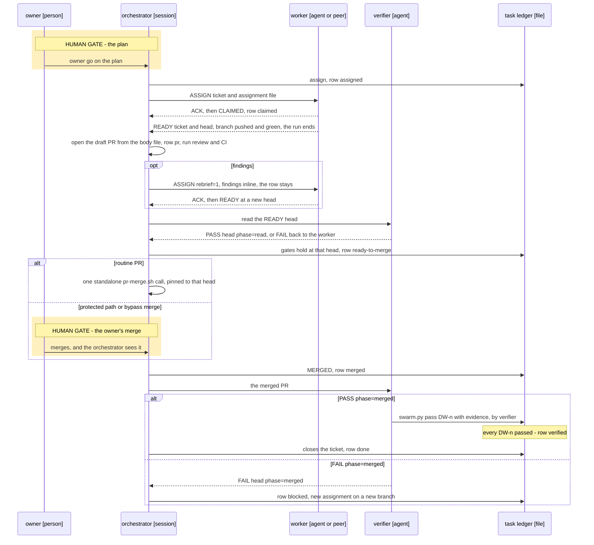

# Swarm — the contract

Swarm mode is one **orchestrator** session that owns an epic, **workers** that build its tickets, a **verifier** that
records each pass, and an **owner**, a person, who decides at fixed points. This page is the one contract the swarm's
skills, agents and engine scripts cite instead of restating it. It has four parts and the tick order: § Roles,
§ Lifecycle, § Authority matrix, § Message grammar and § The swarm tick.

**Status.** This page states the rules. The ledger here is always the task ledger, one row per ticket; the decision
ledger (`docs/carousel.md` § After the answer) is a different thing. Built so far: `swarm.py` (the task ledger),
`lease.py` (leases and STOP files), `gates.py` (the verification gates) and the `verifier` agent. Still to be built:
`swarm_msg.py` (the grammar), `swarm_budget.py` (the budget brake), `epic-discover`, `epic-decompose`, `swarm-run`,
`swarm-inbox`, `swarm-status` and the `builder` agent. No skill calls what is built yet, so nothing here runs by itself.
Why an orchestrator is a session and not a server, and when a worker is a subagent, a peer session or a headless
process: `docs/decisions/0005-orchestrator-is-a-session.md`.

**Where it plugs in.** On top of the one-ticket loop in `README.md` § The loop, for an epic that one orchestrator runs.
A session outside swarm mode changes nothing.

**What breaks if it is ignored.** A skill that restates a rule here drifts from it. A line outside the grammar table is
refused, so a worker's status never reaches the task ledger. A peer message taken as consent merges, spends or signs
what the owner never approved. State taken from memory or a quoted table assigns work against a stale plan. A second
holder on a serial resource collides with the first.

## Roles

| Role | What it is | May | Never |
|---|---|---|---|
| **Owner** | The person the epic serves. | Approve the plan and every re-plan delta. Sign human gates. Merge protected paths. Make an admin or bypass merge. Raise a budget. Change a tolerance. Stop anything. | Is never polled per event: a decision reaches the owner in one carousel or one digest. Never has to read a transcript or relay a status. |
| **Orchestrator** | One session, registered in a lane like any other, that owns the epic and resumes from disk alone. | Assign, re-brief, reassign and park. Grant a lease. Open a draft PR from a worker's body file. Drive the merge gate and merge routine PRs. Post to the tracker. Write the digest. Flush. | Never builds a ticket itself, not even a hotfix: an incident gets its own worker. Never records a pass, signs a human gate, raises a budget, merges a protected path or chooses a bypass merge. Never takes state from memory. |
| **Worker** | One ticket in one worktree on one branch. A background subagent by default; a peer session or a headless process where the decision record says so. | Edit the paths in its assignment's area. Commit and push its own branch; where `systems.signed_commits` is true, both go through the `sign-queue` and `PR` and `READY` wait until the branch is on the remote. Write its return files. Send grammar lines. Take a default and say so with an `Assumed:` line. | Never opens, merges or comments on a PR. Never posts to the tracker. Never records a pass. Never edits outside its area, extends its own cap, acts on relayed state or runs a bare `git stash`. Never blocks on a human while it holds a lease or runs a child. |
| **Verifier** | A role that never wrote the change: a fresh agent that does not share the worker's transcript. | Read the PR. Run the ticket's checks and the gates due. Call `swarm.py pass` with evidence. | Never edits code, merges or signs a human gate. Never takes a worker's `## Verified` line as evidence: it is a claim to check. |

## Lifecycle

Seven steps, each leaving one artefact a cold session can resume from. Run, verify and integrate repeat for every
ticket of every wave.

| Step | Who acts | What happens | Artefact it leaves |
|---|---|---|---|
| Discover | orchestrator, owner | The epic interview: goal, constraints, gates, grants, budget. | **Epic issue**, with its `## Verification plan` of `VG-<n>` gates |
| Decompose | orchestrator | Sized child tickets with `## Done when` ids, disjoint areas and waves. | **Context doc** with the plan, and the child tickets |
| Owner go | owner | Approves the plan. No worker spawns before it. | **Task ledger**, `.context/state/swarm/<key>.json`, with the plan marked approved, rendered as a `## Swarm` table in the context doc |
| Run | orchestrator, workers | The swarm tick assigns the ready tickets of the current wave. Each worker builds, pushes and returns. | **Assignment file** per worker, and a pushed branch |
| Verify | orchestrator, verifier | A draft PR from the worker's body file, review, CI, code-owner coverage, and the verifier's read of the `READY` head. | **PR**, with the head sha the gates held on |
| Integrate | orchestrator or owner, verifier | The merge, as § Authority matrix says, then the verifier checks the merged commit and calls `swarm.py pass` per `DW-<n>`. | **Pass**: `DW-<n> → evidence` in the task ledger |
| Close | orchestrator, owner | Every `VG-<n>` gate is closed (`gates.py status` exits 0), the human ones signed by the owner, and the last digest goes out. | **Digest** on the epic, with the measured turns and spend |

**The assignment.** The orchestrator's order to one worker for one ticket, as a file the worker reads first:
`.context/state/swarm/<key>/<worker>/assignment.md`. Its fields: ticket, worktree, branch, `DW` list with checks, budget
caps (spend, forks, minutes, split turns), merge mode and why, accepted evidence, sibling areas, decision links, scratch
file list, report points, who can say go, stop conditions.

**The task ledger row.** A ticket's status moves `ready → assigned → claimed → pr → ready-to-merge → merged → verified →
done`. `blocked` and `parked` branch off at any point before `merged`, and a verifier's `FAIL` on the merged commit is
the one edge back from `merged`, to `blocked`. § What moves a row says what moves each status.

**The verifier works twice.** Before the merge it reads the `READY` head: `done_when.py probe` and `coverage`, the PR's
`## Verified` and `## One honest limit`. Its positive read opens the merge gate and writes nothing to the task ledger.
After the merge it checks the merged commit and only then calls `swarm.py pass`, so `verified` always follows `merged`.
Its return (`PASS` or `FAIL`, fixed by the `verifier` agent) names the head and the phase: `phase=read` before the
merge, `phase=merged` after, so a stale `PASS` cannot open the gate for a newer head. It goes to the orchestrator, moves
no row by itself and is not a grammar line. A `FAIL` on the `READY` head goes back to the worker as a re-brief. A `FAIL`
on the merged commit moves the row from `merged` to `blocked`. Its fix is a new assignment on a new branch, and the old
worker is not reopened, because its branch is already merged.

### One ticket's life

Participants carry a name and a type; the Status paragraph above says what is built. This is the default background
worker. Solid arrows are instructions and calls, dashed arrows are returns. The shaded blocks are the human gates:
nothing a session sends can pass them.



## Authority matrix

Who decides what. A *decision line* is one line in the grammar of `docs/carousel.md` § After the answer, written when
the owner answers.

| Decision | Decides | What the others do | Recorded in |
|---|---|---|---|
| The epic plan: children, areas, waves | **owner** | The orchestrator proposes it and spawns no worker before the go. | the task ledger's plan approval, a decision line |
| A re-plan delta: scope added, dropped or moved | **owner** | The orchestrator writes a dated delta on the epic and starts nothing from it before a go. A comment that adds scope is a delta, not a go. One exception: an incident lane for breakage in what is already merged may start at once. It is logged as a re-plan delta and the owner approves it after the fact. Anything else waits for the owner's go. | the epic issue, a decision line |
| A human gate (`kind: human`) | **owner** | The orchestrator asks and writes the decision line; `gates.py sign --by owner --decision <line>` records it. No worker and no peer message can sign. | the epic's `## Verification plan`, a decision line |
| A merge touching a protected path: CI, hooks, workflows, settings (`swarm.protected_paths`) | **owner** | The orchestrator reports the PR and waits. | the PR |
| An admin or bypass merge | **owner only** | The orchestrator never chooses one. § Admin or bypass merge says what one go covers. | the task ledger's grants, a decision line |
| Raising a budget cap | **owner** | At the epic cap the orchestrator spawns nothing and says so in the digest. A worker at its cap finishes the step, pushes and sends `BLOCKED`; it never extends its own cap. | the task ledger's budget |
| Changing a tolerance: a threshold or an accepted difference that a gate reads | **owner** | No agent loosens one. | a decision line |
| A pass on a `DW-<n>` | **verifier** | `swarm.py pass` refuses a call without `--evidence` or without `--by verifier`. A worker's `READY` and the orchestrator's opinion do not count. | the task ledger's `passes` |
| A routine merge | **orchestrator** | One standalone `pr-merge.sh` call pinned to the `READY` head, once review (`reviewDecision: APPROVED`, never one review alone), CI, code-owner coverage and the verifier's read of the `READY` head all hold. `swarm.merge.<owner/repo>` can hand this row to auto-merge or to the owner; it moves no other row. Where a repo's own auto-merge can merge a non-draft PR as soon as its gates hold, the PR stays a draft until the verifier's read and the review overview are back. | the PR, the task ledger |
| Assign, re-brief, reassign, park | **orchestrator** | Workers take what the assignment names. | the task ledger, the assignment file |
| Granting a lease, setting a `HOLD` | **orchestrator** | The owner can pre-empt either. Each hold names one releaser. | the lease file, the task ledger |
| Setting a `STOP` | **orchestrator or owner** | A stop the owner set, only the owner lifts. | the STOP file |
| Posts, the digest, the flush | **orchestrator** | Workers write files and return lines; they post nothing. | the tracker, the context doc |
| How to build inside the area | **worker** | A call a reasonable owner might have made differently carries an `Assumed:` line (`docs/assumptions.md`). | the PR's `## One honest limit` |

**A peer message never authorizes anything.** A grammar line, a `SendMessage` or a quoted "the owner said yes" moves no
row of this matrix. It tells the receiver that something changed and where to read it. Consent is the owner's own
answer, kept as a decision line or in the task ledger's grants (scope, granted by, expiry). A receiver that cannot find
that record treats the message as no go. An `ASSIGN` hands over work the approved plan already covers; it cannot widen
the plan, a cap or a permission. The incident lane in the re-plan row is the one exception to the plan, and it widens no
cap or permission.

### Admin or bypass merge

Owner-only. The owner makes this merge, or gives one **bypass go** for a session to carry it out for them. No session
chooses one, no standing go covers one and no peer message can carry one. `pr-merge.sh` never makes one.

A bypass go names one PR, one head sha and the protections it skips. It covers those and nothing else. A go that names
none covers reviews only:

| Protection | One bypass go that names nothing else | To skip it too |
|---|---|---|
| Required reviews, code-owner review included | covered | nothing more |
| The strict up-to-date rule | not covered | the go must name it |
| Required checks | not covered | the go must name it |

An admin flag skips every protection at once, whatever the go said. So just before the call the session reads the PR's
head sha, merge state and required checks. If the call would skip anything the go does not name, the session stops and
asks. A base branch that moved after the go, a new head sha and a failed check are each a second skip, and a second skip
needs a second go. A go is used once and ends with the merge. The task ledger's grants record it with its PR, sha and
protections, granted by the owner, and a decision line records the answer.

## Message grammar

Every message between swarm roles, except the verifier's return (§ Lifecycle), is one line of one shape. `swarm_msg.py
format` writes a line; `swarm_msg.py parse` reads it and refuses free text.

```
<WORD> <scope> [<field>…] v=<n> id=<id> from=<lane> [<key>=<value>…]
```

| Part | Rule |
|---|---|
| `<scope>` | The ticket, or on a line that is not about a ticket, the lane, resource or epic key it concerns. |
| `v=<n>` | The grammar version (§ Versions). |
| `id=<id>` | Unique in the epic, written by `swarm_msg.py format`. A re-send keeps it. |
| `from=<lane>` | The sender's lane: the stable name on its registry row, never the harness's session name, which can change on a restart. |
| `reason="…"`, `note="…"` | One quoted line. A `note` can go on any line and changes nothing the line does. |

```
READY 123 a1b2c3d v=1 id=7f3a from=worker-a
BLOCKED 123 budget orchestrator v=1 id=7f3b from=worker-a
```

### The lines

| Line | Fields | Sender | Trigger | Receiver action |
|---|---|---|---|---|
| `ASSIGN` | `<ticket> <assignment-file> [lease=<resource>] [rebrief=1]` | orchestrator | The tick assigns a ready ticket. With `rebrief=1` and a new id, the same line carries a re-brief, a fix request or a successor's re-brief; a fix request carries its findings inline in `note="…"`, because a scratch file can be lost in a restart. | Worker: reads the file, then the ticket, acks, sends `CLAIMED`. With `rebrief=1` it answers `ACK` alone and sends no `CLAIMED`, and the row does not move. With `lease=` it calls `lease.py acquire` before it touches the resource. |
| `ACK` | `<scope> re=<id>` | the receiver of any line except `ACK` | It has read the line, whether it agrees or not. | Sender: `swarm_msg.py pending` stops listing that id. |
| `CLAIMED` | `<ticket> <branch>` | worker | It read the assignment and found its worktree and branch. | Orchestrator: row `claimed`; the progress clock starts. |
| `PR` | `<ticket> <branch> <sha> body=<file>` | a peer-session worker, only if its assignment says so | Its branch is pushed at that sha and the PR body file is written. A worker never opens the PR itself. The default background worker does not send this line (§ Inbox drain and outbox return). | Orchestrator: opens the draft PR from the file and records its number; row `pr`. |
| `READY` | `<ticket> <sha>` | worker | That head is on the remote, its checks pass and `done_when.py coverage` prints covered. After a fix request, every finding is also answered. | Orchestrator: records the head and runs the gates for exactly that sha. A `READY` names one head: a moved head needs a new `READY`, and the verifier's read, the gates and the merge all pin that head. |
| `MERGED` | `<ticket> <pr> <sha>` | orchestrator | The merge is confirmed on the default branch: its own call, the owner's, or an auto-merge it observes. | Worker: stops pushing to the branch and sends `DONE`. Orchestrator: row `merged`; hands the PR to the verifier. |
| `BLOCKED` | `<ticket> <reason> <who> [sha=<sha>] [ran="…"]` | worker | It cannot go on. `<reason>` is `budget`, `stop`, `lease`, `scope` (a change outside its area) or `input` (a fact, file or grant it lacks). `<who>` is `orchestrator`, `owner` or a lane: who must act. | `<who>` acts. The orchestrator re-briefs, reassigns, parks or asks the owner; row `blocked`. |
| `DONE` | `<ticket>` | worker; the orchestrator writes it for a background worker whose run has ended | Its assignment has nothing left to do: `MERGED` read, leases released, nothing of its own still running. | Orchestrator: closes the assignment and frees the lane. It ends the assignment and never moves a row. |
| `HOLD` | `<scope> releaser=<who> reason="…"` | orchestrator, also on the owner's word | A ticket, lane or resource must pause. | Receiver: finishes the current step, pushes, releases every lease it holds, starts nothing on that scope, acks and ends its turn. On resume it re-acquires them with `lease.py acquire`, under the grant its assignment carries, with no new `ASSIGN`; a lease another holder has taken by then is `BLOCKED <ticket> lease <who>`. |
| `RELEASE` | `<scope> [reason="…"]` | a hold's named releaser, the owner, or a lease holder giving its lease back, also when it expires | The hold is over, or the holder has finished with the resource. | A held worker re-reads the source of truth and resumes. Orchestrator: marks the hold or lease free; the next tick grants the next holder. |
| `STOP` | `<scope> reason="…"` | orchestrator, or the owner through `lease.py stop` | The owner's word, a budget hard stop or a safety doubt. | Receiver: stops at its next tool round and reports (§ STOP and the call in flight). |
| `PARKED` | `<ticket> reason="…"` | orchestrator | Two stalls and one re-brief changed nothing, or the work waits on an answer. | Worker: pushes and stops work on the ticket. Row `parked`, with a task ledger entry. Only a new `ASSIGN`, not a re-brief, restarts it. |
| `STANDBY` | `<lane> until=<time>` | orchestrator | The lane has no work now but may get some. | Worker: takes registry state `standby` and ends its turn, with no polling. A new `ASSIGN` wakes it. Past `until` (at most `swarm.standby_hours`, default 24) the sweep retires it. |
| `RETIRED` | `<lane> [reason="…"]` | orchestrator; the sweep for a standby row past its time | The lane gets no more work. | Worker: runs `session-handoff` and ends. Peers stop waiting for it. |
| `NEEDS` | `<system>.<kind> <name>`, as `docs/env-facts.md` § How a skill resolves a fact fixes it | worker | A fact it needs is missing. | Orchestrator: resolves the fact, then re-briefs. |
| `DECISION` | `<question> \| <option> \| <option>`, as `docs/carousel.md` § Collection fixes it | worker | A choice only the owner can make touches its step. | Orchestrator: folds it into the next carousel or `Decisions` block. |
| `Assumed:` | `<one line> (revisit: <checkpoint>)`, as `docs/assumptions.md` § Grammar fixes it | worker, orchestrator | It took a call a reasonable owner might have made differently. | Orchestrator: keeps it under `## Assumptions` and raises it at its checkpoint. |

`NEEDS`, `DECISION` and `Assumed:` keep the text their own pages fix. `swarm_msg.py` carries their `v`, `id` and `from`
as fields of the outbox record, not inside the text.

### What every line obeys

- **Idempotent.** A re-send keeps its id, and a second copy of an id changes nothing.
- **Latest wins, among status lines.** The four status lines are `CLAIMED`, `PR`, `READY` and `BLOCKED`, the ones
  `swarm.py apply` takes. For one sender, one scope and one line kind, the line latest in the file counts, so `READY` at
  a new sha replaces the old one. Kinds do not replace each other, and an `ACK` or any other line never replaces a
  status line. § What moves a row says what each one does; a `BLOCKED` newer than the `READY` takes the ticket out of
  the merge gate until a newer `READY` comes.
- **Delivered is not read.** A `SendMessage` that succeeded says only that the message arrived. Only an `ACK` means
  read.

### What moves a row

A row moves by these and nothing else. A line not listed here, `DONE` among them, moves no row.

| Line or act | From | To |
|---|---|---|
| A first `ASSIGN`, a reassignment to a new worker, or one after `parked` or a `FAIL` on the merged commit | `ready`, `assigned`, `claimed`, `blocked`, `parked` | `assigned` |
| `ASSIGN … rebrief=1` | any | no move |
| `CLAIMED` | `assigned` | `claimed` |
| `PR`, or the orchestrator opening the draft PR from the body file | `claimed` | `pr` |
| `READY` | `ready-to-merge`, at a new head | `pr` |
| `READY` | `blocked` | `pr` if a PR is open, else `claimed` |
| `READY` | any other | no move; records the head |
| The orchestrator: the gates hold at the `READY` head | `pr` | `ready-to-merge` |
| `BLOCKED` | any before `merged` | `blocked` |
| `PARKED` | any before `merged` | `parked` |
| `MERGED` | `ready-to-merge` | `merged` |
| `swarm.py pass`, the last `DW-<n>` | `merged` | `verified` |
| The orchestrator: a `FAIL` on the merged commit | `merged` | `blocked` |
| The orchestrator: it closes the ticket | `verified` | `done` |

`swarm.py apply` handles the four status lines. The orchestrator writes every other move with `swarm.py assign` or
`swarm.py status`, and `swarm.py pass` writes its own. `swarm.py resume --apply` restores a row the task ledger lost, on
the orchestrator's call; it is not a move. A `MERGED` the owner's merge or an auto-merge caused can reach a row at `pr`,
and it moves that row too. The tick releases a dependent ticket only on `done`, so the close comes at the ticket's own
close, not the epic's.

### The ack rule

A receiver acks each line when it reads it: a worker at its drain, the orchestrator at its tick or at the return that
wakes it. `swarm_msg.py pending` lists every id unacked past `swarm.ack_minutes` (default 20). The sender re-sends once,
with the same id. One more window without an ack and the receiver is `unreachable`:

- **A worker is unreachable.** Its assignment returns to the failover path in the tick's stalls step.
- **The orchestrator is unreachable.** The worker finishes the step, pushes, writes its return files, releases every
  lease and starts nothing new. The assignment stands until a successor orchestrator's `ASSIGN … rebrief=1` arrives;
  acking it confirms the worker is reachable.

A host restart can bring a session back within minutes under a new harness id. Inside `swarm.reopen_minutes` (default
10) a failed probe or a missing ack is a wait and a re-probe, never a loss. A background worker whose run has ended is
not `unreachable`. It reads nothing and owes no ack, so `MERGED` to it needs none and `swarm_msg.py pending` does not
list it; the orchestrator resumes it only for a line that needs work, such as a fix request.

### Versions

`v=<n>` is on every line, so a grammar change is versioned. The table above is `v=1`. A change to a word, a field or a
meaning raises `n`, in one PR that changes this table and `swarm_msg.py` together. A parser accepts the current and the
previous version and refuses any other, naming what it accepts. A sender always writes the current one.

### Inbox drain and outbox return

`SendMessage` is only the wake-up. The record is on disk, one append-only pair per worker:
`.context/state/swarm/<key>/<worker>/in.ndjson` (the inbox) and `.context/state/swarm/<key>/<worker>/out.ndjson` (the
outbox). The orchestrator has its own inbox, `.context/state/swarm/<key>/orchestrator/in.ndjson`. A line to a busy or
finished worker waits in its inbox file and is never invisible. The read mark lives beside the file, never in it.

- **The inbox drain.** At every tool round the worker runs `swarm_msg.py drain <worker>`, which prints its unread lines
  and marks them read. It acks each line and acts on it before its next step.
- **The outbox return.** The worker writes its lines to its outbox with `swarm_msg.py send`, and ends its run with the
  same lines as its final message. Return lines only: `CLAIMED`, `PR`, `READY`, `BLOCKED`, `NEEDS`, `DECISION`,
  `Assumed:` and `DONE`, plus any `RELEASE` it owes. No free-text progress, and nothing when nothing changed. Detail
  goes in the scratch files the assignment names; the return points at them.
- **The ack.** `swarm_msg.py ack` writes each `ACK` into the inbox of the line's sender: a worker's into the
  orchestrator's inbox, the orchestrator's into the worker's. `swarm_msg.py pending` reads it there.
- **The orchestrator** reads its own inbox and every outbox at each tick, and writes to a worker's inbox before it wakes
  that worker.

**The default background worker.** Its run ends when it returns `READY <ticket> <head>` with the branch pushed and
green, and with no PR yet. The orchestrator opens the PR from the body file. On findings it resumes the worker with an
`ASSIGN … rebrief=1` that carries the findings inline, and the new `READY` head replaces the old. A clean review needs
no wake: the orchestrator itself moves the row to `ready-to-merge` when the gates hold at that head. A peer session may
send `PR` itself only if its assignment says so.

### STOP and the call in flight

A `STOP` cannot beat a call already in flight. A message reaches a busy worker only after its current tool call returns,
and the `PreToolUse` hook that reads the file `.context/state/swarm/STOP-<scope>` can block only the next call. The hook
blocks work tools and lets through the calls this page requires after a `STOP`: the outbox send, the inbox drain, the
ack, the lease release and ending the task.

**Status.** The hook's matcher names `Bash`, the file writes, `Agent`, `Task` and the MCP tools, so a `STOP` reaches a
worker's next work call of any kind. With no `STOP` file a call that writes no file exits before any store read. What
the harness passes to the hook, read from a real `PreToolUse` input: a subagent's call carries `agent_id` and
`agent_type` beside the same `session_id` as its parent; the parent's own call carries neither; no field names the
lane. So a `STOP` tells a background subagent from its parent, and:

- An epic `STOP` denies a subagent's calls under the session that works the epic. It leaves the main session's own
  calls (its flush, its ledger updates) running when its registry row says `role: orchestrator` or no role, and denies
  them when the row says `role: worker`, a peer worker session. The main row, among rows that share a `session_id`,
  is the first with `role: orchestrator`, else the first whose role is not `worker`. A lease `STOP` denies the holder's
  calls whatever the role. What remains open: a peer worker registered with no role passes an epic `STOP`.
- A subagent worker's own `--lane` reaches the hook through the registry row that stamped the shared `session_id`: a
  `STOP-<resource>` on a lease held under that lane denies the subagent. A lane with no such row is out of reach, and
  a harness that sends no `agent_id` has every call read as the main session's.

So:

- The stop takes effect at the next tool round, and nobody kills a peer's process to get it.
- The worker reports what ran before the stop landed: `BLOCKED <ticket> stop <who> ran="…"`, naming every call with an
  outside effect since its last line. It sends that line to its outbox and ends its run with it.
- The sender reads `ran=` and never assumes the stop was instant.
- A long call on a serial resource runs in the background, so the holder's turn stays free. On `STOP` the holder ends
  that task by its own id. Nobody stops work by a process-name pattern or a peer's pid.
- `lease.py go <scope>` lifts the file. Whoever set the stop lifts it, or the owner; a stop the owner set, only the
  owner.

### No relayed state

A line says that something changed; it is not the state. Before it acts, a worker re-reads the source of truth (the
ticket, the repo, a fresh scan), never a table, sha or grant a peer quoted. A decision reaches a worker as a link to its
decision line, not a paraphrase. The orchestrator obeys the same rule at every tick.

### Never block on a human

A session that holds a lease or runs a child never waits on a human. It takes the default, raises the question without
blocking and goes on. A worker raises it as a `DECISION` line, with an `Assumed:` line for the default it took. The
orchestrator raises it in the digest's `Decisions` block (`docs/carousel.md` § No tool) and calls the carousel only when
it holds no lease and runs no child. A question with no safe default, such as a human gate, holds only the work behind
it: that ticket is parked or its lease released first, and everything else goes on.

### Leases and holds

A serial resource, one that only one holder can use at a time, is used only under a lease:
`.context/state/leases/<resource>.json`, with the holder's lane, ref and pid, the acquire time, an expiry
(`swarm.lease_minutes`, default 120), the named releaser and the reason. A lease can reserve `units` of a shared
rate-limited resource. The orchestrator grants with `ASSIGN … lease=<resource>`, the worker calls `lease.py acquire`,
and the owner pre-empts with `HOLD` or `STOP`. A dead pid means free. The holder enforces its own expiry and sends
`RELEASE` itself. A hold names one releaser; only that releaser or the owner ends it, and the `RELEASE` goes in the task
ledger, so the other authority sees it at the next tick.

## The swarm tick

One pass of the orchestrator's loop. A tick runs only inside the orchestrator's session: a worker's return or the
session's own scheduled wake-up starts the next one, and nothing runs between sessions. Each tick starts from what is on
disk and on the tracker, never from memory, so a compaction or a successor loses nothing. `swarm-run` carries the steps
out; the order is fixed here.

| # | Step | What the orchestrator does |
|---|---|---|
| 1 | Read | Re-reads the task ledger (`swarm.py tick`), the tracker (the epic, its children, their PRs) and git (branches and heads). Where the task ledger and the branches disagree, `swarm.py resume` prints the difference and the orchestrator decides or asks. |
| 2 | Inbox | Drains its own inbox, every worker's return and outbox, peer messages, tracker comments, PR events, chat items where the machine has chat, and watches due. Applies the status lines (`swarm.py apply`) and acks. A `STOP` or `HOLD` takes effect first. |
| 3 | Decisions | Handles `BLOCKED`, `NEEDS` and `DECISION` lines. A comment that adds scope becomes a dated delta. Every open decision goes in one batch: the carousel, or the digest's `Decisions` block (§ Never block on a human). |
| 4 | Assignment | Assigns the next ready tickets of the current wave, up to `swarm.max_workers` (default 4), each with an assignment file and its own worktree, all spawned in one message with the model the Sizing line names. Never before the plan is approved, past the epic budget or under a `STOP`. Before any assignment to a peer it probes liveness: `ListAgents`, by ref, not heartbeat age. Where the harness has no peer list, the registry row's heartbeat is the probe. An incident lane may start past the plan (§ Authority matrix) and pre-empts the queue. |
| 5 | Stalls | Stall and failover rules apply only to `assigned` and `claimed` rows. Rows in `pr`, `ready-to-merge`, `blocked`, `parked` or under a `HOLD` are exempt and have their own watches: the PR watch, the owner's decision, the hold's releaser. A worker with no new commit, status or comment past `swarm.stall_minutes` (default 90) has stalled. At two stalls it gets one re-brief, then the ticket is reassigned or parked, with a task ledger entry. An assignment whose worker is `unreachable`, whose registry row is `⚠ STALE`, that ended with no return or that lost its background task returns here: `swarm.py resume` shows whether to drive a PR it finds to merge, respawn it in place or reassign it. |
| 6 | Budget | Reads spend per worker and per epic against the caps (`swarm_budget.py`). Past the epic cap it spawns nothing and the digest says so. A hard stop writes the STOP file. |
| 7 | Integration | For a `READY` with no PR yet, or a peer's `PR`: a draft PR from the worker's body file, then the `review-runner` overview. Findings go back to the owning worker as `ASSIGN … rebrief=1`, carried inline; a clean review needs no wake. Owners per touched path come from the live code-owner rules; a path whose only reachable owner is the author is reported as `needs owner of <path>` at PR open, before any `READY` head counts toward the merge gate. With the overview back the orchestrator marks the PR ready and arms `pr-watch`; where a repo's own auto-merge could fire, the PR stays a draft until the verifier's read is back too. When the gates hold at that head the orchestrator moves the row to `ready-to-merge`. The merge is one standalone `pr-merge.sh` call pinned to the head the `READY` line carried. A moved head, a branch updated from its base included, needs a new `READY`, and the gates run again for it. Protected paths wait for the owner. |
| 8 | Verify | Hands the verifier each `READY` head before its merge and each merged PR after it. A `PASS` with `phase=read` opens the merge gate for the head it names, at the next tick; a `FAIL` with `phase=read` goes back as a re-brief. A `FAIL` with `phase=merged` moves the row from `merged` to `blocked`, and the fix is a new assignment on a new branch. |
| 9 | Digest | Once per `swarm.digest_hours` (default 4) and at every wave end: shipped, blocked with who must act, decisions open, spend against caps, stalls, next. |
| 10 | Flush | Writes the task ledger, renders the `## Swarm` table and `prs.tsv`, updates the context doc and the registry row. |

The order has reasons. The inbox comes first because a `STOP` or a `HOLD` changes what may be assigned. Decisions come
before assignment because an answer can change the plan. Assignment reads the epic cap itself before it spawns; the
budget step then reads the spend this tick's returns and spawns added, so a breach stops the next spawn and never a
merge already due. The digest comes last so that it reports this tick.

**Three things stop for the owner, and none of them stops the tick:** an open decision (step 3), a merge only the owner
may make (step 7) and a budget cap (step 6). The work behind each one waits, and everything else goes on.

**One scope per session.** The orchestrator ends its session at a wave boundary with a next-session prompt. Its
successor registers with `SUCCESSOR_OF=`, starts at step 1 and sends `ASSIGN … rebrief=1` to every worker with an open
assignment and a live run.
