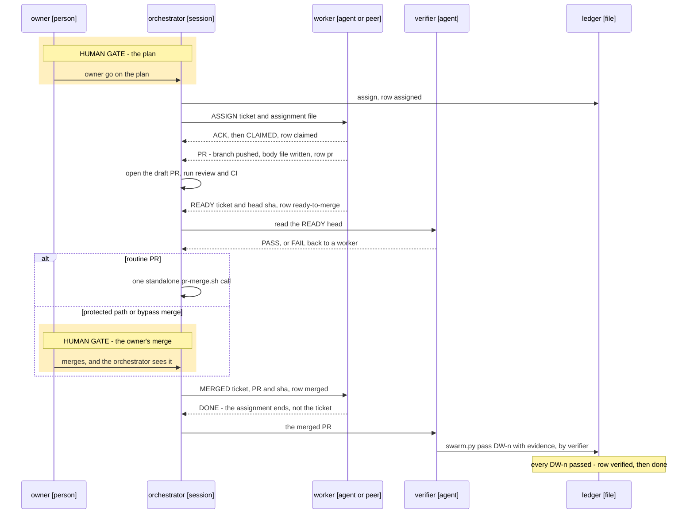

# Swarm — the contract

Swarm mode is one **orchestrator** session that owns an epic, **workers** that build its tickets, a **verifier** that
records each pass, and an **owner**, a person, who decides at fixed points. This page is the one contract the swarm's
skills, agents and engine scripts cite instead of restating it. It has four parts and the tick order: § Roles,
§ Lifecycle, § Authority matrix, § Message grammar and § The swarm tick.

**Status.** This page states the rules. The engine tickets build the scripts it names: `swarm.py` (the ledger),
`swarm_msg.py` (the grammar), `lease.py` (leases and STOP files), `swarm_budget.py` (the budget brake) and `gates.py`
(the verification gates). The skill tickets build `epic-discover`, `epic-decompose`, `swarm-run`, `swarm-inbox`,
`swarm-status` and the `builder` and `verifier` agents. None of these exists on this head yet, so nothing here runs by
itself. Why an orchestrator is a session and not a server, and when a worker is a subagent, a peer session or a
headless process: `docs/decisions/0005-orchestrator-is-a-session.md`.

## Roles

| Role | What it is | May | Never |
|---|---|---|---|
| **Owner** | The person the epic serves. | Approve the plan and every re-plan delta. Sign human gates. Merge protected paths. Make an admin or bypass merge. Raise a budget. Change a tolerance. Stop anything. | Is never polled per event: a decision reaches the owner in one carousel or one digest. Never has to read a transcript or relay a status. |
| **Orchestrator** | One session, registered in a lane like any other, that owns the epic and resumes from disk alone. | Assign, re-brief, reassign and park. Grant a lease. Open a draft PR from a worker's body file. Drive the merge gate and merge routine PRs. Post to the tracker. Write the digest. Flush. | Never builds a ticket itself, not even a hotfix: an incident gets its own worker. Never records a pass, signs a human gate, raises a budget, merges a protected path or chooses a bypass merge. Never takes state from memory. |
| **Worker** | One ticket in one worktree on one branch. A background subagent by default; a peer session or a headless process where the decision record says so. | Edit the paths in its assignment's area. Commit and push its own branch. Write its return files. Send grammar lines. Take a default and say so with an `Assumed:` line. | Never opens, merges or comments on a PR. Never posts to the tracker. Never records a pass. Never edits outside its area, extends its own cap, acts on relayed state or runs a bare `git stash`. Never blocks on a human while it holds a lease or runs a child. |
| **Verifier** | A role that never wrote the change: a fresh agent that does not share the worker's transcript. | Read the PR. Run the ticket's checks and the gates due. Call `swarm.py pass` with evidence. | Never edits code, merges or signs a human gate. Never takes a worker's `## Verified` line as evidence: it is a claim to check. |

## Lifecycle

Seven steps, each leaving one artefact a cold session can resume from. Run, verify and integrate repeat for every
ticket of every wave.

| Step | Who acts | What happens | Artefact it leaves |
|---|---|---|---|
| Discover | orchestrator, owner | The epic interview: goal, constraints, gates, grants, budget. | **Epic issue**, with its `## Verification plan` of `VG-<n>` gates |
| Decompose | orchestrator | Sized child tickets with `## Done when` ids, disjoint areas and waves. | **Context doc** with the plan, and the child tickets |
| Owner go | owner | Approves the plan. No worker spawns before it. | **Ledger**, `.context/state/swarm/<key>.json`, with the plan marked approved, rendered as a `## Swarm` table in the context doc |
| Run | orchestrator, workers | The swarm tick assigns the ready tickets of the current wave. Each worker builds, pushes and returns. | **Assignment file** per worker, and a pushed branch |
| Verify | orchestrator, verifier | A draft PR from the worker's body file, review, CI, code-owner coverage, and the verifier's read of the `READY` head. | **PR**, with the head sha the gates held on |
| Integrate | orchestrator or owner, verifier | The merge, as § Authority matrix says, then the verifier checks the merged commit and calls `swarm.py pass` per `DW-<n>`. | **Pass**: `DW-<n> → evidence` in the ledger |
| Close | orchestrator, owner | Every `VG-<n>` gate is closed (`gates.py status` exits 0), the human ones signed by the owner, and the last digest goes out. | **Digest** on the epic, with the measured turns and spend |

**The assignment.** The orchestrator's order to one worker for one ticket, as a file the worker reads first:
`.context/state/swarm/<key>/<worker>/assignment.md`. Its fields: ticket, worktree, branch, `DW` list with checks, budget
caps (spend, forks, minutes, split turns), merge mode and why, accepted evidence, sibling areas, decision links, scratch
file list, report points, who can say go, stop conditions.

**The ledger row.** A ticket's status moves `ready → assigned → claimed → pr → ready-to-merge → merged → verified → done`.
`blocked` and `parked` branch off at any point before `merged`. § Message grammar names the line that moves each status.

**The verifier works twice.** Before the merge it reads the `READY` head: `done_when.py probe` and `coverage`, the PR's
`## Verified` and `## One honest limit`. Its positive read opens the merge gate and writes nothing to the ledger. After
the merge it checks the merged commit and only then calls `swarm.py pass`, so `verified` always follows `merged`. Its
return (`PASS` or `FAIL`, fixed by the `verifier` agent) goes to the orchestrator, moves no row by itself and is not a
grammar line. A `FAIL` at either point goes back to a worker as a new `ASSIGN`.

### One ticket's life

Participants carry a name and a type; the Status paragraph above says what is built. Solid arrows are instructions and calls,
dashed arrows are returns. The shaded blocks are the human gates: nothing a session sends can pass them.



## Authority matrix

Who decides what. A *decision line* is one line in the grammar of `docs/carousel.md` § After the answer, written when
the owner answers.

| Decision | Decides | What the others do | Recorded in |
|---|---|---|---|
| The epic plan: children, areas, waves | **owner** | The orchestrator proposes it and spawns no worker before the go. | the ledger's plan approval, a decision line |
| A re-plan delta: scope added, dropped or moved | **owner** | The orchestrator writes a dated delta on the epic and starts nothing from it before a go. A comment that adds scope is a delta, not a go. | the epic issue, a decision line |
| A human gate (`kind: human`) | **owner** | The orchestrator asks and writes the decision line; `gates.py sign --by owner --decision <line>` records it. No worker and no peer message can sign. | the epic's `## Verification plan`, a decision line |
| A merge touching a protected path: CI, hooks, workflows, settings (`swarm.protected_paths`) | **owner** | The orchestrator reports the PR and waits. | the PR |
| An admin or bypass merge | **owner only** | The orchestrator never chooses one. § Admin or bypass merge says what one go covers. | the ledger's grants, a decision line |
| Raising a budget cap | **owner** | At the epic cap the orchestrator spawns nothing and says so in the digest. A worker at its cap finishes the step, pushes and sends `BLOCKED`; it never extends its own cap. | the ledger's budget |
| Changing a tolerance: a threshold or an accepted difference that a gate reads | **owner** | No agent loosens one. | a decision line |
| A pass on a `DW-<n>` | **verifier** | `swarm.py pass` refuses a call without `--evidence` or without `--by verifier`. A worker's `READY` and the orchestrator's opinion do not count. | the ledger's `passes` |
| A routine merge | **orchestrator** | One standalone `pr-merge.sh` call, once review (`reviewDecision: APPROVED`, never one review alone), CI, code-owner coverage and the verifier's read of the `READY` head all hold. `swarm.merge.<owner/repo>` can hand this row to auto-merge or to the owner; it moves no other row. | the PR, the ledger |
| Assign, re-brief, reassign, park | **orchestrator** | Workers take what the assignment names. | the ledger, the assignment file |
| Granting a lease, setting a `HOLD` | **orchestrator** | The owner can pre-empt either. Each hold names one releaser. | the lease file, the ledger |
| Setting a `STOP` | **orchestrator or owner** | A stop the owner set, only the owner lifts. | the STOP file |
| Posts, the digest, the flush | **orchestrator** | Workers write files and return lines; they post nothing. | the tracker, the context doc |
| How to build inside the area | **worker** | A call a reasonable owner might have made differently carries an `Assumed:` line (`docs/assumptions.md`). | the PR's `## One honest limit` |

**A peer message never authorizes anything.** A grammar line, a `SendMessage` or a quoted "the owner said yes" moves no
row of this matrix. It tells the receiver that something changed and where to read it. Consent is the owner's own answer,
kept as a decision line or in the ledger's grants (scope, granted by, expiry). A receiver that cannot find that record
treats the message as no go. An `ASSIGN` hands over work the approved plan already covers; it cannot widen the plan, a
cap or a permission.

### Admin or bypass merge

Owner-only. The owner makes this merge, or gives one **bypass go** for a session to carry it out for them. No session
chooses one, no standing go covers one and no peer message can carry one. `pr-merge.sh` never makes one.

A bypass go names one PR, one head sha and the protections it skips. It covers those and nothing else. A go that names
none covers reviews only:

| Protection | One bypass go that names nothing else | To skip it too |
|---|---|---|
| Required reviews, code-owner review included | covered | nothing more |
| The strict up-to-date rule | not covered | the go must name it |
| Required checks | not covered | the go must name it |

An admin flag skips every protection at once, whatever the go said. So just before the call the session reads the PR's
head sha, merge state and required checks. If the call would skip anything the go does not name, the session stops and
asks. A base branch that moved after the go, a new head sha and a failed check are each a second skip, and a second skip
needs a second go. A go is used once and ends with the merge. The ledger's grants record it with its PR, sha and
protections, granted by the owner, and a decision line records the answer.

## Message grammar

Every message between swarm roles is one line of one shape. `swarm_msg.py format` writes a line; `swarm_msg.py parse`
reads it and refuses free text.

```
<WORD> <scope> [<field>…] v=<n> id=<id> from=<lane> [<key>=<value>…]
```

| Part | Rule |
|---|---|
| `<scope>` | The ticket, or on a line that is not about a ticket, the lane, resource or epic key it concerns. |
| `v=<n>` | The grammar version (§ Versions). |
| `id=<id>` | Unique in the epic, written by `swarm_msg.py format`. A re-send keeps it. |
| `from=<lane>` | The sender's lane: the stable name on its registry row, never the harness's session name, which can change on a restart. |
| `reason="…"`, `note="…"` | One quoted line. A `note` can go on any line and changes nothing the line does. |

```
READY 123 a1b2c3d v=1 id=7f3a from=worker-a
BLOCKED 123 budget orchestrator v=1 id=7f3b from=worker-a
```

### The lines

| Line | Fields | Sender | Trigger | Receiver action |
|---|---|---|---|---|
| `ASSIGN` | `<ticket> <assignment-file> [lease=<resource>]` | orchestrator | The tick assigns a ready ticket. The same line with a new id carries a re-brief, a fix request or a successor's re-brief; the file says what changed. | Worker: reads the file, then the ticket, acks, sends `CLAIMED`. With `lease=` it calls `lease.py acquire` before it touches the resource. |
| `ACK` | `<scope> re=<id>` | the receiver of any line except `ACK` | It has read the line, whether it agrees or not. | Sender: `swarm_msg.py pending` stops listing that id. |
| `CLAIMED` | `<ticket> <branch>` | worker | It read the assignment and found its worktree and branch. | Orchestrator: row `claimed`; the progress clock starts. |
| `PR` | `<ticket> <branch> <sha> body=<file>` | worker | Its branch is pushed at that sha and the PR body file is written. A worker never opens the PR itself. | Orchestrator: opens the draft PR from the file and records its number; row `pr`. |
| `READY` | `<ticket> <sha>` | worker | That head is pushed, its checks pass, `done_when.py coverage` prints covered and every review finding is answered. | Orchestrator: row `ready-to-merge`; runs the gates for exactly that sha. A head that moved needs a new `READY`, unless the merge gate's own update from the base moved it. |
| `MERGED` | `<ticket> <pr> <sha>` | orchestrator | The merge is confirmed on the default branch, by its own call or the owner's. | Worker: stops pushing to the branch and sends `DONE`. Orchestrator: row `merged`; hands the PR to the verifier. |
| `BLOCKED` | `<ticket> <reason> <who> [sha=<sha>] [ran="…"]` | worker | It cannot go on. `<reason>` is `budget`, `stop`, `lease`, `scope` (a change outside its area) or `input` (a fact, file or grant it lacks). `<who>` is `orchestrator`, `owner` or a lane: who must act. | `<who>` acts. The orchestrator re-briefs, reassigns, parks or asks the owner; row `blocked`. |
| `DONE` | `<ticket>` | worker; the orchestrator writes it for a background worker whose run has ended | Its assignment has nothing left to do: `MERGED` read, leases released, nothing of its own still running. | Orchestrator: closes the assignment and frees the lane. It ends the assignment, not the ticket: the row reaches `done` only from `verified`. |
| `HOLD` | `<scope> releaser=<who> reason="…"` | orchestrator, also on the owner's word | A ticket, lane or resource must pause. | Receiver: finishes the current step, pushes, releases every lease it holds, starts nothing on that scope, acks and ends its turn. |
| `RELEASE` | `<scope> [reason="…"]` | a hold's named releaser, or a lease holder giving its lease back, also when it expires | The hold is over, or the holder has finished with the resource. | A held worker re-reads the source of truth and resumes. Orchestrator: marks the hold or lease free; the next tick grants the next holder. |
| `STOP` | `<scope> reason="…"` | orchestrator, or the owner through `lease.py stop` | The owner's word, a budget hard stop or a safety doubt. | Receiver: stops at its next tool round and reports (§ STOP and the call in flight). |
| `PARKED` | `<ticket> reason="…"` | orchestrator | Two stalls and one re-brief changed nothing, or the work waits on an answer. | Worker: pushes and stops work on the ticket. Row `parked`, with a ledger entry. Only a new `ASSIGN` restarts it. |
| `STANDBY` | `<lane> until=<time>` | orchestrator | The lane has no work now but may get some. | Worker: takes registry state `standby` and ends its turn, with no polling. A new `ASSIGN` wakes it. Past `until` (at most `swarm.standby_hours`, default 24) the sweep retires it. |
| `RETIRED` | `<lane> [reason="…"]` | orchestrator; the sweep for a standby row past its time | The lane gets no more work. | Worker: runs `session-handoff` and ends. Peers stop waiting for it. |
| `NEEDS` | `<system>.<kind> <name>`, as `docs/env-facts.md` § How a skill resolves a fact fixes it | worker | A fact it needs is missing. | Orchestrator: resolves the fact, then re-briefs. |
| `DECISION` | `<question> \| <option> \| <option>`, as `docs/carousel.md` § Collection fixes it | worker | A choice only the owner can make touches its step. | Orchestrator: folds it into the next carousel or `Decisions` block. |
| `Assumed:` | `<one line> (revisit: <checkpoint>)`, as `docs/assumptions.md` § Grammar fixes it | worker, orchestrator | It took a call a reasonable owner might have made differently. | Orchestrator: keeps it under `## Assumptions` and raises it at its checkpoint. |

`NEEDS`, `DECISION` and `Assumed:` keep the text their own pages fix. `swarm_msg.py` carries their `v`, `id` and `from` as
fields of the outbox record, not inside the text.

### What every line obeys

- **Idempotent.** A re-send keeps its id, and a second copy of an id changes nothing.
- **Latest per ticket wins.** For one sender and one scope, the line latest in the file counts. `READY` at a new sha
  replaces the old one; `BLOCKED` after `READY` takes the ticket out of the merge gate. From `merged` on, only `DONE`, the
  verifier's pass and a new `ASSIGN` move a row.
- **Delivered is not read.** A `SendMessage` that succeeded says only that the message arrived. Only an `ACK` means read.

### The ack rule

A receiver acks each line when it reads it: a worker at its drain, the orchestrator at its tick or at the return that
wakes it. `swarm_msg.py pending` lists every id unacked past `swarm.ack_minutes` (default 20). The sender re-sends once,
with the same id. One more window without an ack and the receiver is `unreachable`:

- **A worker is unreachable.** Its assignment returns to the failover path in the tick's stalls step.
- **The orchestrator is unreachable.** The worker finishes the step, pushes, writes its return files, releases every
  lease and starts nothing new. The assignment stands until a successor orchestrator's `ASSIGN` re-brief arrives; acking
  it confirms the worker is reachable.

A host restart can bring a session back within minutes under a new harness id. Inside `swarm.reopen_minutes` (default 10)
a failed probe or a missing ack is a wait and a re-probe, never a loss. A background worker whose run has ended reads
nothing and owes no ack; the orchestrator resumes it only for a line that needs work, such as a fix request.

### Versions

`v=<n>` is on every line, so a grammar change is versioned. The table above is `v=1`. A change to a word, a field or a
meaning raises `n`, in one PR that changes this table and `swarm_msg.py` together. A parser accepts the current and the
previous version and refuses any other, naming what it accepts. A sender always writes the current one.

### Inbox drain and outbox return

`SendMessage` is only the wake-up. The record is on disk, one append-only pair per worker:
`.context/state/swarm/<key>/<worker>/in.ndjson` (the inbox) and `.context/state/swarm/<key>/<worker>/out.ndjson` (the
outbox). A line to a busy or finished worker waits in its inbox file and is never invisible.

- **The inbox drain.** At every tool round the worker runs `swarm_msg.py drain <worker>`, which prints its unread lines
  and marks them read. It acks each line and acts on it before its next step.
- **The outbox return.** The worker writes its lines to its outbox with `swarm_msg.py send`, and ends its run with the
  same lines as its final message. Return lines only: `CLAIMED`, `PR`, `READY`, `BLOCKED`, `NEEDS`, `DECISION`,
  `Assumed:` and `DONE`, plus any `ACK` and `RELEASE` it owes. No free-text progress, and nothing when nothing changed.
  Detail goes in the scratch files the assignment names; the return points at them.
- **The orchestrator** reads every outbox at each tick and writes to a worker's inbox before it wakes that worker.

### STOP and the call in flight

A `STOP` cannot beat a call already in flight. A message reaches a busy worker only after its current tool call returns,
and the `PreToolUse` hook that reads the file `.context/state/swarm/STOP-<scope>` can block only the next call. So:

- The stop takes effect at the next tool round, and nobody kills a peer's process to get it.
- The worker reports what ran before the stop landed: `BLOCKED <ticket> stop <who> ran="…"`, naming every call with an
  outside effect since its last line. That line is its final message, because the hook blocks its tools.
- The sender reads `ran=` and never assumes the stop was instant.
- A long call on a serial resource runs in the background, so the holder's turn stays free. On `STOP` the holder ends that
  task by its own id. Nobody stops work by a process-name pattern or a peer's pid.
- `lease.py go <scope>` lifts the file. Whoever set the stop lifts it, or the owner; a stop the owner set, only the owner.

### No relayed state

A line says that something changed; it is not the state. Before it acts, a worker re-reads the source of truth (the
ticket, the repo, a fresh scan), never a table, sha or grant a peer quoted. A decision reaches a worker as a link to its
decision line, not a paraphrase. The orchestrator obeys the same rule at every tick.

### Never block on a human

A session that holds a lease or runs a child never waits on a human. It takes the default, raises the question without
blocking and goes on. A worker raises it as a `DECISION` line, with an `Assumed:` line for the default it took. The
orchestrator raises it in the digest's `Decisions` block (`docs/carousel.md` § No tool) and calls the carousel only when
it holds no lease and runs no child. A question with no safe default, such as a human gate, holds only the work behind
it: that ticket is parked or its lease released first, and everything else goes on.

### Leases and holds

A serial resource, one that only one holder can use at a time, is used only under a lease:
`.context/state/leases/<resource>.json`, with the holder's lane, ref and pid, the acquire time, an expiry
(`swarm.lease_minutes`, default 120), the named releaser and the reason. A lease can reserve `units` of a shared
rate-limited resource. The orchestrator grants with `ASSIGN … lease=<resource>`, the worker calls `lease.py acquire`, and
the owner pre-empts with `HOLD` or `STOP`. A dead pid means free. The holder enforces its own expiry and sends `RELEASE`
itself. A hold names one releaser; only that releaser or the owner ends it, and the `RELEASE` goes in the ledger, so the
other authority sees it at the next tick.
