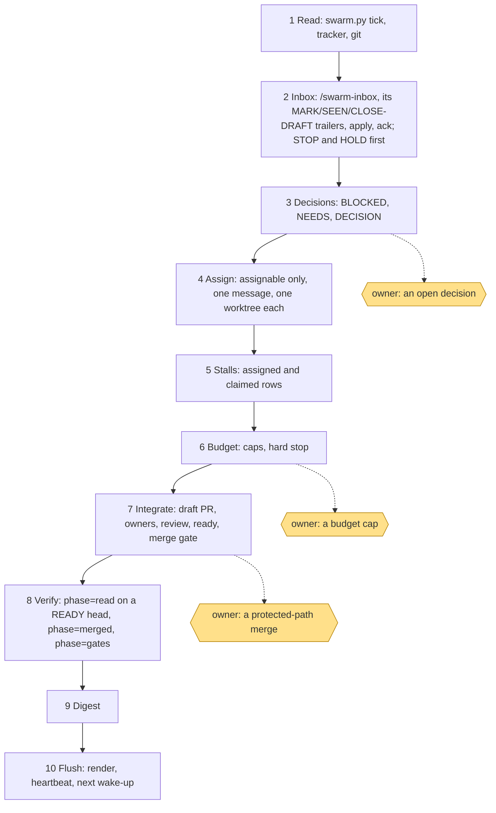

# flow.md — one tick as a picture

The order is `docs/swarm.md` § The swarm tick. The three shaded stops wait for the owner; none of them stops the tick:
the work behind each one waits, and everything else goes on.

Why this order: the inbox comes first because a `STOP` or a `HOLD` changes what may be assigned; decisions come
before assignment because an answer can change the plan; assignment reads the epic cap itself, and the budget step
then reads what this tick's returns and spawns added, so a breach stops the next spawn and never a merge already due;
the digest comes last so it reports this tick.
